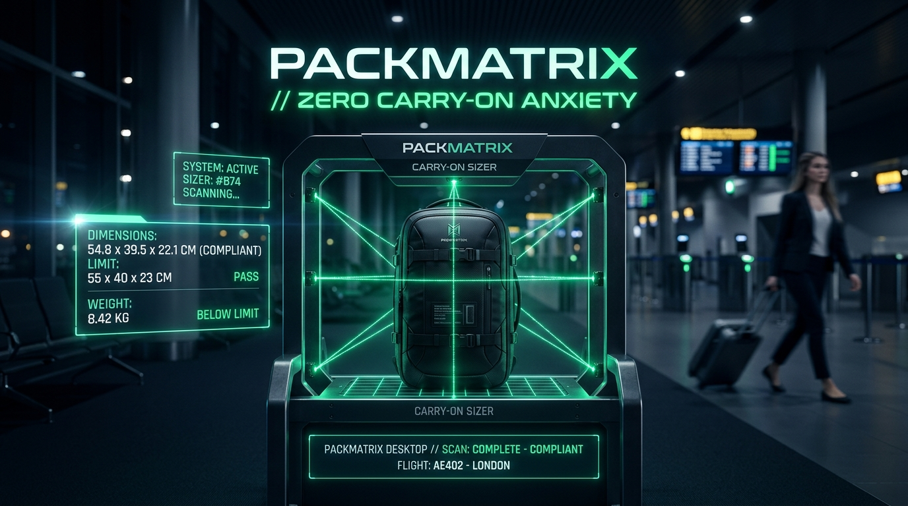

<div align="center">

# 🧳 PackMatrix Desktop
### Local-First Luggage Geometry Optimizer & Spatial Gear Suite

**Eliminate carry-on anxiety. Convert physical packing into deterministic spatial engineering.**

[](https://tauri.app)
[](https://www.rust-lang.org)
[](https://www.typescriptlang.org)
[](https://react.dev)
[](https://sqlite.org)
[](https://github.com)
[](https://github.com)
[](LICENSE)

[Features](#-key-features) • [Visual Tour](#-visual-interface-tour) • [Architecture](#-architectural-overview) • [Tech Stack](#-technology-stack) • [Quickstart](#-quickstart--installation) • [Contributing](#-contributing) • [SDLC & Security](#-production-sdlc--security)

<br/>

<p align="center">
  
</p>

</div>

---

## ✈️ Why PackMatrix?

Airlines are turning airport gates into high-stress toll booths—shrinking overhead bin thresholds, enforcing rigid metal sizers, and imposing unexpected gate-check baggage fees. Meanwhile, travelers, one-bag minimalists, and gear professionals (photographers, field audio engineers, remote workers) are left guessing whether their bags will slide under the seat or survive the luggage carousel.

**PackMatrix Desktop** replaces physical guesswork with **computational certainty**.

Built on a native **Rust core** and rendered via an aviation-grade **Tauri v2** desktop canvas, PackMatrix models non-rectangular luggage geometries, simulates nested compression cubes, calculates exact 3D center-of-mass distributions, and audits your loadout against live airline sizers—**all completely offline and private to your personal workstation**.

---

## 🖥️ Visual Interface Tour

```
┌────────────────────────────────────────────────────────────────────────────────────────┐
│ ☰ [🧳 PackMatrix] Luggage Geometry & Volumetric Optimizer    [Search gear ⌘K]  [IN/LBS] [AL]│
├──────────────────────────┬─────────────────────────────────────────────────────────────┤
│ WORKSPACE                │ ACTIVE BAG: Peak Design Travel Backpack 45L                │
│ [✈ Transatlantic Summer] │ 21.1 × 13.0 × 9.5 in [Depth Alert: -0.4 in]                 │
│  FRA → JFK · Jun 14      │ [VOLUME: 91% (38.4/42L)]    [WEIGHT: Under Limit (18.5/22.0lbs)]│
│                          ├──────────────────────────────┬──────────────────────────────┤
│ 💼 My Packing       (18) │ 🛡️ Lufthansa Cabin Envelope   │ PACKED ITEMS CHECKLIST       │
│ 🎒 Saved Bags            │ [21.7×15.7×9.1 in] [17.6 lbs]│ 18 items · 14.0 lbs gear     │
│ 🧊 Packing Cubes         │ Verified 12m ago · Compliant │ [+ Add Item] [🖨 Print]       │
│ 📋 Airline Baggage Rules ├──────────────────────────────┼──────────────────────────────┤
│ ☑ Gear Checklist         │ 🧳 FRONT LAYOUT BAG MOCKUP   │ [All] [Clothing] [Tech] ...  │
│ 📄 Trip Documents        │ [Front Layout] [Balance] [✓] │ 🎧 ELECTRONICS & WORK (10.6lbs)│
│                          │ ┌──────────────────────────┐ │ ☑ MacBook Pro 16"   75.5 oz  │
│                          │ │ Quick-Access / TSA Bay   │ │ ☑ Anker GaN 65W     11.3 oz  │
│                          │ │ [TSA Liquids] [Passport] │ │ ☑ Sony WH-1000XM5    8.8 oz  │
│                          │ ├──────────────────────────┤ ├──────────────────────────────┤
│                          │ │ Tech Spine Sleeve (45Wh) │ │ 👕 CLOTHING (CUBE L) (4.2lbs) │
│                          │ ├──────────────────────────┤ │ ☑ Outlier Pants     32.5 oz  │
│                          │ │ Main Cavity: Cubes & Gear│ │ ☑ Atom LT Jacket    13.2 oz  │
│                          │ ├──────────────────────────┤ │ [✔ All items cabin-ready]    │
│                          │ │ Footwear Bay (Base)      │ └──────────────────────────────┘
│                          │ └──────────────────────────┘                                │
│                          │ Free Space Buffer: 3.6 L Available (8% Reserve)            │
└──────────────────────────┴─────────────────────────────────────────────────────────────┘
```

---

## ⚡ Key Features

### 🧳 Interactive Visual Bag Interior Mockup
* **100% Manifest Visibility:** Every packed item is visually rendered inside natural bag compartments (no missing clothes or hidden items).
* **Organized Equipment Compartments:**
  * **Quick-Access & TSA Liquids Bay (Amber):** Toiletries, 3-1-1 compliant liquids pouch, passport, wallet, sunglasses, keys.
  * **Tech Spine & Electronics Sleeve (Violet):** Laptops, tablets, headphones, cameras, power banks, and chargers positioned flush against the back panel for optimal spine leverage.
  * **Main Internal Cavity & Wardrobe Bay (Blue):** Modular compression cubes with real-time compression ratios **plus** a dedicated Folded Garments & Loose Gear grid.
  * **Footwear Bay (Slate):** Shoes, sneakers, and boots anchored at the bottom base to keep the center of gravity low.
  * **Dynamic Free Space Buffer (Teal):** Real-time available liters and capacity reserve gauge.
* **Interactive Equipment Cards:** Displays item icon, name, brand, weight, dimensions, compliance tags (`75ml`, `99Wh`, `60% fold`), and a one-click Unpack (`×`) action button.

### 📐 Non-Rectangular Luggage Hull Geometry Engine
* **Analytical Hull Taper:** Calculate true usable volume accounting for top-to-bottom hull taper ($0.50 \le \tau \le 1.00$).
* **Corner Bevel Calculus:** Circular quadrant edge deductions eliminate phantom volume along rounded luggage perimeters:
  $$\Delta V_{\text{bevel}} = \frac{(4 - \pi) \cdot r^2 \cdot D}{1000}$$
* **Dynamic Expansion Gussets:** Toggle zipper expansion with live volumetric capacity recalculation.
* **Side-by-Side Luggage Comparison:** Compare two bags across usable volume, dimensions, empty weight, gussets, and underseat taper.

### ⚖️ 3D Ergonomic Centroid & Spine Balance Solver
* **Discrete Mass Centroid ($X, Y, Z$):** Real-time 3D center-of-mass simulation preventing muscle fatigue and spinal curvature.
* **Spine-Flush Heuristic:** Proactively flags heavy dense items placed away from back panels ($Y_{\text{com}} > 0.40 \times D_{\text{max}}$).
* **Lateral Balance & Tip Prevention:** Identifies left/right asymmetric mass distribution and top-heavy tipping risks.

### 🔄 Universal Unit System Consistency (Metric & Imperial)
* **One-Click Unit Switcher:** Toggle instantaneously between **Metric (CM / KG / G)** and **Imperial (IN / LBS / OZ)**.
* **Full Application Consistency:** All modals (Bag Creator/Editor, Bag Comparison, New Gear Item, Add Item to Bag, Packing Cubes, New Trip, Gate Sizer) dynamically update labels and input fields.
* **Zero Data Drift:** Live conversions maintain double-precision mathematical invariance with canonical SQLite persistence.

### 🔍 Offline Local-First Product & Bag Autocomplete
* **Zero Guesswork Catalog:** Integrated offline specifications for popular luggage (Peak Design, Osprey, Tortuga, Aer, Rimowa) and electronics/gear (Sony, Apple, Bose, Anker, Patagonia, Lenovo).
* **Hierarchical Brand Navigation:** Browse models by brand or search by keyword with automatic pre-population of mass, dimensions, battery watt-hours, and compressibility.

### 🛡️ Airline Sizer Compliance & Regulatory Auditing
* **149 Global Airline Envelopes:** Offline dimensions for Personal Item, Overhead Carry-On, and Checked baggage across major international carriers.
* **Interactive Gate Sizer Collision Box:** Visual diagram displaying exact dimensional clearances and depth obstruction alerts.
* **TSA / ICAO 3-1-1 Liquids Audit:** Validates 100ml individual bottle limits and 1-quart aggregate pouch capacity.
* **FAA / ICAO Lithium Battery Safety:** Computes aggregate watt-hours ($Wh$) with safety threshold alerts ($100\,Wh$ carry-on limits).

### 🔒 Zero-Telemetry & Local Data Sovereignty
* **100% Air-Gapped Operation:** No cloud accounts, no login walls, zero telemetry, zero analytics tracking beacons.
* **SQLite Write-Ahead Logging (WAL):** Atomic, crash-resilient persistence with sub-millisecond FTS5 search across $10,000+$ gear items.
* **Disaster Recovery & Clean Export:** Pre-migration snapshot watchdog, SQLite file quarantine recovery, uncompressed JSON data export, and RFC-4180 CSV import with formula injection neutralization.

---

## 🏛️ Architectural Overview

PackMatrix uses a modern, ultra-lightweight hybrid desktop architecture combining memory-safe Rust with an agile web front-end:

```
┌────────────────────────────────────────────────────────────────┐
│               FRONTEND PRESENTATION LAYER                      │
│     Vite + TypeScript 7 + React 19 + Lucide + Vanilla CSS      │
│    (Zero layout-thrashing, 60/120fps spatial canvas, a11y)     │
└──────────────────────────────┬─────────────────────────────────┘
                               │ Typed JSON-RPC IPC (Zero-Copy)
┌──────────────────────────────▼─────────────────────────────────┐
│                 TAURI v2 NATIVE DESKTOP CORE                   │
│   ┌─────────────────────┬──────────────────────────────────┐   │
│   │ Geometry Engine     │ Center-of-Mass Physics Solver    │   │
│   │ (Taper, Bevels)     │ (Spine-Flush Ergonomics)         │   │
│   ├─────────────────────┼──────────────────────────────────┤   │
│   │ Airline Sizer Rules │ Local SQLite WAL Database Handle │   │
│   │ (149 Carriers)      │ (FTS5 Search, Foreign Keys)      │   │
│   └─────────────────────┴──────────────────────────────────┘   │
└──────────────────────────────┬─────────────────────────────────┘
                               │ Local Storage (Air-Gapped)
┌──────────────────────────────▼─────────────────────────────────┐
│             OS APPLICATION STORAGE (OFFLINE)                   │
│    macOS ~/Library/Application Support · Windows %AppData%     │
└────────────────────────────────────────────────────────────────┘
```

---

## 🛠️ Technology Stack

| Component | Technology | Version | Purpose |
| :--- | :--- | :--- | :--- |
| **Core Framework** | [Tauri](https://tauri.app) | `v2.12.4` | Native desktop windowing, OS integration, secure IPC bridge |
| **Backend Core** | [Rust](https://www.rust-lang.org) | `1.80+` | Computational geometry, physics balance solver, SQLite handles |
| **Storage Engine** | [rusqlite](https://github.com/rusqlite/rusqlite) | `0.40.2` | Embedded SQLite with WAL mode, foreign keys, and FTS5 search |
| **Frontend Framework** | [React](https://react.dev) | `19.2.8` | Declarative UI state and high-density components |
| **Language & Typings** | [TypeScript](https://www.typescriptlang.org) | `7.0.2` | Strict type-checking across frontend and IPC contracts |
| **Build & Bundling** | [Vite](https://vitejs.dev) | `8.3.4` | Sub-second HMR and production bundle optimization |
| **Icons & Visuals** | [Lucide React](https://lucide.dev) | `1.59.0` | Crisp, scalable technical vector iconography |
| **Design System** | Vanilla CSS Tokens | Custom | Cockpit aesthetic, typography, and blueprint styling |

---

## 📂 Repository Structure

```
packmatrix-desktop/
├── index.html                   # HTML entrypoint with Plus Jakarta Sans typography
├── package.json                 # Frontend dependencies (TypeScript 7, React 19, Vite)
├── tsconfig.json                # Root TypeScript configuration
├── tsconfig.app.json            # Strict frontend TypeScript compiler settings
├── vite.config.ts               # Vite build configuration
├── SDLC.md                      # Exhaustive Enterprise SDLC & Security Specification
├── README.md                    # Project overview and contributor documentation
├── src/                         # Frontend presentation layer
│   ├── main.tsx                 # React DOM mount
│   ├── App.tsx                  # High-density cockpit UI & workspace frame
│   ├── index.css                # Design system tokens, cockpit styling, schematic canvas
│   ├── types/                   # TypeScript interfaces (Luggage, Gear, Rules, Units)
│   ├── utils/                   # Unit conversion utilities and data validators
│   ├── data/                    # Curated bag presets & product catalogs
│   ├── hooks/                   # Reactive state, SQLite hooks, virtual scroll
│   ├── services/                # Local IPC bridge and catalog search lookup
│   └── components/
│       ├── common/              # Autocomplete, modals (Settings, New Trip)
│       └── views/               # My Packing, Saved Bags, Cubes, Rules, Checklist, Docs
└── src-tauri/                   # Native Rust desktop backend
    ├── Cargo.toml               # Rust dependencies (Tauri v2, rusqlite 0.40, serde)
    ├── tauri.conf.json          # Tauri window boundaries, CSP, and capabilities
    ├── build.rs                 # Tauri build automation script
    ├── migrations/              # SQLite versioned schema migrations
    │   └── 001_initial_schema.sql # WAL mode, foreign keys, FTS5 virtual tables
    ├── icons/                   # Multi-resolution application icons
    └── src/
        ├── main.rs              # Native application entrypoint
        ├── lib.rs               # Tauri command registration & IPC bridge
        ├── geometry/            # Bounding box calculus, bevels, tapers, 3D balance
        ├── db/                  # SQLite connection pooling & transactional migrations
        ├── inventory/           # Gear catalog aggregations & compressibility models
        ├── compliance/          # Airline cabin sizer rule evaluation engine
        └── export/              # Canonical JSON and CSV portability generation
```

---

## 🚀 Quickstart & Installation

### Pre-built Binaries (End Users)
Download the latest signed release for your platform from [Releases](https://github.com):

* **macOS:** Download `.dmg` (Universal binary: Apple Silicon `M1/M2/M3/M4` and Intel).
* **Windows:** Download `.msi` or standalone `.exe` installer (x64 / ARM64).
* **Linux:** Download `.AppImage` or `.deb` package.

---

### Building from Source (Developers)

#### Prerequisites
* [Rust](https://www.rust-lang.org/tools/install) ($\ge 1.80$)
* [Node.js](https://nodejs.org) ($\ge 20.x \text{ LTS}$)
* Platform-specific Tauri dependencies:
  * **macOS:** Xcode Command Line Tools (`xcode-select --install`)
  * **Linux:** `sudo apt-get install libwebkit2gtk-4.1-dev build-essential curl wget file libxdo-dev libssl-dev libayatana-appindicator3-dev librsvg2-dev`
  * **Windows:** C++ Build Tools & WebView2

#### 1. Clone the Repository
```bash
git clone https://github.com/boredpolymath/packmatrix-desktop.git
cd packmatrix-desktop
```

#### 2. Install Dependencies
```bash
npm install
```

#### 3. Run Development Server
```bash
# Starts Vite frontend with Hot Module Replacement & native Tauri wrapper
npm run tauri dev
# or run the frontend web canvas in browser:
npm run dev
```

#### 4. Run Verification Suite
```bash
# Run Rust unit, geometry calculus, and SQLite migration test suites (92 tests)
cd src-tauri && cargo test

# Verify frontend types and linting
npx tsc -p tsconfig.app.json --noEmit
npx oxlint

# Run end-to-end SDLC validation audits & production build
npm test
npm run build

# Run automated pre-commit verification gate
./.githooks/pre-commit
```

---

## 🤝 Contributing: Join the Flight Crew!

PackMatrix Desktop is crafted for travelers, engineers, and digital minimalists. Whether you love optimizing algorithms, designing aviation-grade interfaces, or cataloging obscure airline baggage policies, **there is a place for you here.**

### 🌟 High-Impact Areas to Contribute

| Domain | What You Can Work On | Primary Tech |
| :--- | :--- | :--- |
| **🧮 Computational Geometry** | 3D Bin-packing heuristic solvers, flexible fabric mesh collision, non-convex hull intrusion algorithms | Rust, Linear Algebra |
| **✈️ Airline Rules Engine** | Expanding international airline baggage matrices, commuter rail allowances, and verified JSON sizer schemas | Rust, JSON, SQL |
| **🎨 Cockpit UI & Canvas** | Interactive 3D WebGL / Canvas visualizers, touch gestures, high-density split view layouts, micro-animations | TypeScript, Canvas, CSS |
| **🔒 Security & OS Integrations** | macOS menu bar & Windows tray applets, global hotkey overlays, hardware key derivation | Rust, OS APIs, Tauri v2 |
| **🌐 Data Import Bridges** | Importers for LighterPack, Packfire, gear spreadsheet templates, and receipt OCR manifests | Rust, CSV/JSON Parsers |

### 📋 Contribution Guidelines
1. **Check Good First Issues:** Look for issues tagged `good-first-issue` or `help-wanted`.
2. **Follow Invariants:**
   - Keep the Rust core `#![forbid(unsafe_code)]`.
   - Maintain 100% air-gap and zero telemetry. Never introduce analytics beacons or tracking SDKs.
   - Write unit tests for all mathematical routines and migrations.
3. **Submit a Pull Request:**
   - Create a descriptive feature branch (`feat/airline-iberia-rules` or `fix/taper-integral-precision`).
   - Ensure `cargo test` and `npm run build` pass with zero warnings.
   - Open a PR with clear context, testing steps, and screenshots for UI changes.

---

## 🛡️ Production SDLC & Security

PackMatrix Desktop adheres to an enterprise-grade Software Development Life Cycle:
* **Mathematical Invariants:** IEEE-754 double precision calculus verified across $500,000$ property-based test iterations.
* **Security Controls:** STRIDE threat modeled, strict Content Security Policy (zero `eval()`), SQL parameterized bindings, anti-CSV formula injection.
* **Disaster Recovery:** SQLite WAL auto-checkpointing, automated pre-migration database snapshots, and corruption salvage fallbacks.

👉 **Read the complete specification in [`SDLC.md`](SDLC.md).**

---

## 📄 License & Intellectual Property

PackMatrix Desktop is developed by **Bored Polymath Studios** and licensed under the [MIT License](LICENSE) (or dual Apache-2.0).

---

<div align="center">
  <sub>Engineered with precision for one-bag travelers and volumetric minimalists worldwide.</sub>
</div>
